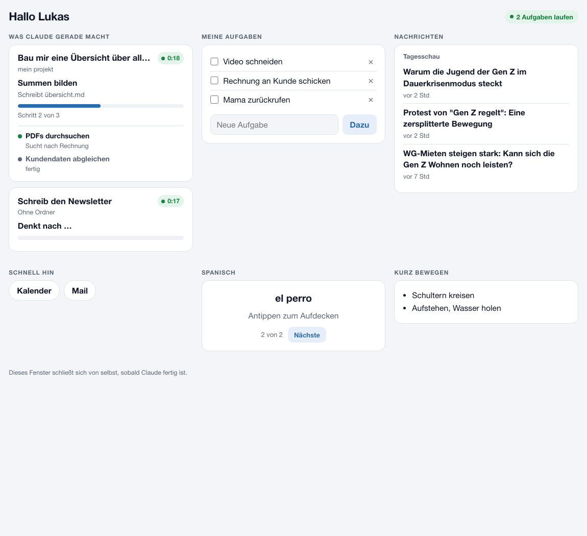

# Wartezeit-Skill für Claude Code

Du gibst Claude Code eine Aufgabe, wartest und greifst zum Handy. Dieser Skill macht stattdessen ein Fenster auf, solange Claude arbeitet: mit deiner To-do-Liste, aktuellen Schlagzeilen und dem Stand, was Claude und seine Helfer gerade machen. Ist Claude fertig, ertönt eine Glocke und das Fenster geht wieder zu.

Was im Fenster steht, bestimmst du. Der Skill fragt dich beim Einrichten, wofür du die Wartezeit nutzen willst.

Aus dem Video von [@lukasxai](https://www.instagram.com/lukasxai/).

## Bitte beachten

**Das läuft nur in Claude Code**, also in der Claude-Desktop-App im Tab „Code" oder im Terminal. Im normalen Chat, im Browser und am Handy funktioniert es nicht, weil Claude dort kein Fenster auf deinem Rechner öffnen kann.

Erprobt ist der Skill auf dem Mac mit Chrome. Für Windows und Linux ist alles vorbereitet, dort ist er aber noch nicht erprobt. Deshalb macht Claude beim Einrichten einen Probelauf mit dir und bessert nach, falls bei dir etwas hakt. Eine Garantie, dass es auf jedem Rechner sofort klappt, gibt es nicht.

Der Skill ändert die Einstellungen von Claude Code auf deinem Rechner (er trägt sieben Befehle ein, die das Fenster steuern). Claude sagt dir vorher, was er ändert, legt eine Sicherung an und fragt nach deinem Ja. Du kannst alles jederzeit pausieren oder wieder entfernen.

## Installieren

Am einfachsten in Claude Code selbst. Schreib dort:

> Installiere den Skill von https://github.com/lukasxai/wartezeit-skill nach ~/.claude/skills/wartezeit und richte ihn ein.

Oder von Hand:

1. Lade [wartezeit-skill.zip](../../releases/latest/download/wartezeit-skill.zip) herunter. Im Browser von Instagram oder TikTok startet der Download nicht, öffne die Seite dafür in Safari oder Chrome.
2. Entpack die Datei und leg den Ordner `wartezeit` nach `~/.claude/skills/`. Oder lade die ZIP-Datei in der Claude-App in den Einstellungen unter Skills hoch.
3. Schreib in Claude Code: „Richte mir die Wartezeit ein."

## Was du sehen kannst

- **Was Claude gerade macht:** Aufgabe, aktueller Schritt, Fortschritt, laufende Zeit. Arbeiten mehrere Sitzungen oder Helfer gleichzeitig, steht jeder mit seinem Stand da.
- **Deine Aufgaben:** eine To-do-Liste zum Abhaken, direkt im Fenster.
- **Nachrichten:** Schlagzeilen zu Themen deiner Wahl.
- **Links:** Knöpfe zu Seiten, die du oft brauchst.
- **Lernkarten:** Vokabeln oder Fachbegriffe zum Aufdecken.
- **Eigene Notizen:** Dehnübungen, Wochenziele, was du willst.

Oder es geht statt des Dashboards einfach eine Seite deiner Wahl auf, zum Beispiel dein Kalender.

## Gut zu wissen

- Das Fenster öffnet sich erst nach ein paar Sekunden. Bei kurzen Antworten bleibt es zu.
- Braucht Claude zwischendurch eine Freigabe von dir, klingelt es auch, damit er nicht unbemerkt wartet.
- Pause: sag Claude „Wartezeit aus". Wieder an: „Wartezeit an". Weg damit: „Wartezeit entfernen".
- Alles bleibt auf deinem Rechner. Nur für die Nachrichten werden die gewählten Nachrichtenseiten abgerufen.

## Grenzen

- Nur Claude Code, kein Chat.
- Das eigene Fenster, das sich wieder schließt, braucht Chrome, Edge oder Brave. Ohne einen davon öffnet sich ein normaler Tab, der offen bleibt.
- Brichst du Claude mitten in der Arbeit ab, bleibt das Fenster offen, bis die nächste Aufgabe endet oder du es schließt.
- Die Anzeige, was Claude gerade macht, ist eine grobe Orientierung.

## Was drin ist

- [`wartezeit/SKILL.md`](wartezeit/SKILL.md): die Anleitung für Claude.
- [`wartezeit/vorlage/hook.sh`](wartezeit/vorlage/hook.sh): öffnet, füttert und schließt das Fenster. Braucht nur bash.
- [`wartezeit/vorlage/dashboard.html`](wartezeit/vorlage/dashboard.html): das Dashboard.
- [`wartezeit/scripts/installieren.sh`](wartezeit/scripts/installieren.sh): kopiert die Dateien an ihren Platz.
